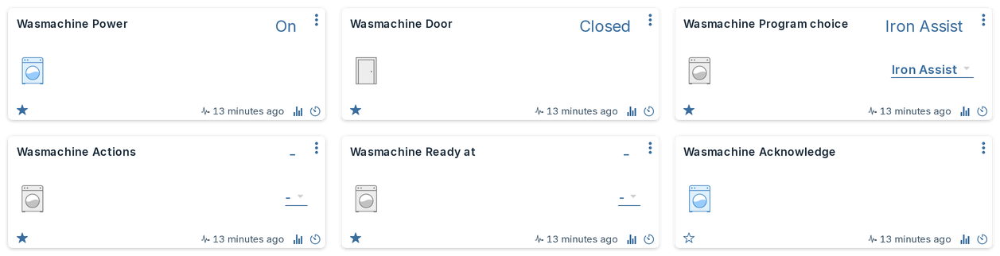

# Control

With control you operate appliances from Domoticz: choose a program, change its options, start
it now or later, and stop, pause or resume it. Scenes, timers and scripts can do the same.

Control is optional. Without it the plugin only shows what your appliances do.

## Before you start

To start a program from Domoticz, three things must be on, and two of them are on the
appliance itself:

1. **Allow control** in the plugin's hardware settings ([Settings](settings.md#allow-control)).
2. **Remote control** on the appliance. You switch it on once, on the appliance itself (usually
   in its settings menu), and it stays on.
3. **Remote start** on the appliance, for each start. You press it on the appliance (often a
   button with a remote or Wi-Fi symbol) when you load it. Home Connect requires this so that
   nothing starts that nobody prepared. It switches itself off again after a while (usually
   about a day).

The **Remote control** device shows which of these the appliance currently allows. "Remote start
allowed" means Domoticz can start it now. When remote control or remote start is off, the plugin
refuses Start itself and the log names what to switch on.

## Choose a program and start it



1. Choose the program on **Program choice**. This selects it on the appliance; it does not
   start it.
2. Change options if you like (temperature, spin speed, duration and so on) on their devices.
3. Choose **Start** on **Actions**.

Actions jumps back to "-" after each command, so you can give the same command again. Choosing
"-" yourself does nothing.

If a command is refused or fails, a short message at the top of the screen says why and what to
do next, for example "The door of Dishwasher is not closed"
([On-screen messages](settings.md#on-screen-messages)). The Domoticz log has the result of every
command.

A scene can do all three steps in one go. The plugin sends them in order and only sends Start
once the appliance has confirmed the program and the options.

## Stop, pause and resume

**Actions** has the same choices on every appliance: Start, Stop, Pause and Resume, and on an
oven with a motorised door also Open door and Partly open door. Not every appliance supports
every action: choosing one the appliance does not offer is refused, and the log says "... is not
offered by ...".

**Acknowledge** confirms a message on the appliance, such as a finished program, as the button
on the appliance does. It is only there on appliances that offer it.

## Start later

Appliances that support a delayed start (for example washers, dryers, dishwashers and some ovens
and microwaves) get one more device: **Start at** or, on laundry appliances, **Ready at**. Its
choices are clock times every half hour.

1. Choose the program (and options).
2. Choose a time on **Start at** / **Ready at**, for example 17:00. Nothing is sent yet; the log
   says "17:00 chosen; it is sent with Start".
3. Choose **Start** on **Actions**. The appliance now waits and starts (or is ready) at that time.
   Its State shows "Delayed start".

Good to know:

- The time is always the next 17:00: in the evening, 07:00 means tomorrow morning.
- "-" means start straight away.
- A chosen time applies to one run. After the program has started, the device is back to "-".
- **Moving the time:** while the appliance waits, choose another time. The plugin changes it on
  the appliance and keeps the old time if the appliance refuses.
- **Starting now instead:** while the appliance waits, stop it and start again with "-".
- A time earlier than the program allows (a 3-hour program cannot be ready in an hour) is
  refused, and the log names the earliest possible time. A time further away than the appliance
  allows is moved to the latest time it accepts, with a log line.

## Values are checked, not bent

Every command is checked against the appliance before anything is sent:

- A value outside an option's range is refused, never clamped: 280 °C on a 250 °C oven is
  refused, with the range in the log.
- A value between steps is rounded to the nearest step, with a log line.
- An option the selected program does not have, or that cannot change while the program runs,
  is refused with what to do instead.

When a command is refused, the device goes back to what the appliance reports, and the Domoticz
log (Setup > Log) shows why. Plugin lines start with the name you gave the hardware; with the
name "Home Connect":

```text
Status: Home Connect: command_refused appliance="Oven" device="Oven Temperature" reason="280 is outside the allowed range for Temperature (30 °C to 250 °C)"
```

[Troubleshooting](faq.md#a-command-is-refused-or-fails) lists the messages and their fixes.

## Scenes, timers and scripts

- **Scenes and timers** store a selector level. The plugin never renumbers levels, so a stored
  level keeps meaning the same program or time.
- **Scenes reach only levels up to 100** (a Domoticz limit): on Program choice that is the first
  10 programs, on Start at / Ready at the times 00:00 to 04:30. A scene stored with a higher level
  does not fail: Domoticz sends level 100 instead, which selects the 10th program or 04:30.
  Timers, dzVents and the dashboard reach every level, so use one of those for the others.
- **Scripts** should read the [Status code](devices.md#status-code-for-scripts) device, not the
  state text, so they keep working in any language.
- Limits protect the appliance and the daily request budget: at most 5 starts and 5 stops a
  minute, as Home Connect allows. Commands keep a reserve of the daily budget free for signing
  in and the event stream; when commands reach it, they are refused and the log names the time
  from which commands fit again.
