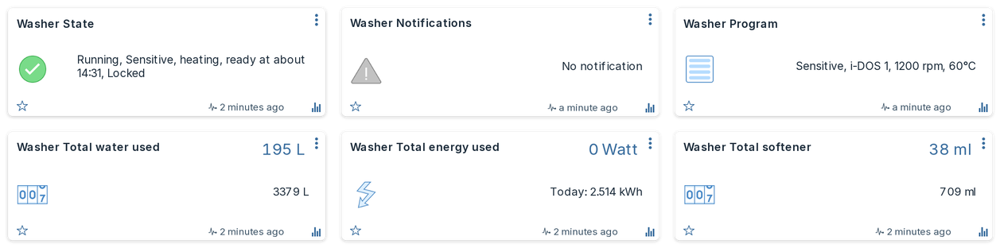

# Devices

After you sign in, every appliance on your Home Connect account gets its own set of devices.
Each device is named after the appliance (the name you gave it in the Home Connect app),
followed by what it shows, for example "Washer Remaining time" or, in Dutch, "Wasautomaat
Resterende tijd".

Every device also has a description (open the device's edit dialog) that explains what it
shows, in the device language.

## The devices every appliance gets

!!! tip "Which theme is this?"
    The screenshots show the [Machinon](https://domoticz.github.io/Machinon/docs/) theme for
    Domoticz. The plugin works the same with any theme.

Not every appliance has all of these: a fridge has no programs, so it gets no program devices,
and a hob can be monitored but not started.

A new appliance puts only a few cards on the dashboard: **State**, **Notifications** and
**Program**, plus a washer's [meters](#washing-machine-meters), plus the control devices when
[Allow control](settings.md#allow-control) is on, plus the few values you operate or watch on
that kind of appliance, such as an oven's set temperature and duration or a fridge's setpoints
and doors ([Options, settings and other values](#options-settings-and-other-values)). The other
devices still exist and scripts can use them; they are created off the dashboard (column "New
device" below, and [Devices off the dashboard](#devices-off-the-dashboard)).

| Device (English / Nederlands) | Type | New device | What it shows |
|---|---|---|---|
| **State** / Status | Alert | shown | The whole run in one line (below). |
| **Notifications** / Meldingen | Alert | shown | The open messages that need you, most serious first (below). Only on an appliance that has sent such a message. |
| **Program** / Programma | Text | shown | The program and the settings that differ from normal (below). |
| **Power** / Aan/uit | Switch | "$", or shown when created with Allow control on | Whether the appliance is on. Many appliances (washers, dryers, fridges) cannot be switched off remotely; switching them off is refused. |
| **Door** / Deur | Door contact | "$" | Open or closed. A locked door counts as closed; "Locked" then also shows in State. |
| **Progress** / Voortgang | Percentage | "$" | How far the running program is, to the percent. |
| **Remaining time** / Resterende tijd | Number (min) | "$" | Minutes until the program ends. For an oven program without a set duration, the time it has been running instead. |
| **Remote control** / Bediening op afstand | Alert | only with Allow control on | Whether Domoticz may start the appliance: "Local operation", "Remote control off", "Remote control on" or "Remote start allowed". |
| **Program choice** / Programmakeuze | Selector | "$", or shown when created with Allow control on | The selected program; with Allow control on, choosing one here selects it on the appliance. |
| **Actions** / Acties | Selector | only with Allow control on | Start, Stop, Pause, Resume, and on an oven with a motorised door Open door and Partly open door. An action the appliance does not support is refused. |
| **Acknowledge** / Bevestigen | Push button | only with Allow control on | Confirms a message on the appliance, where the appliance offers it. |
| **Start at** or **Ready at** / Start om of Klaar om | Selector | only with Allow control on | A clock time for a delayed start. See [Control](control.md#start-later). |
| **Status code** / Statuscode | Selector | "$" | The state as a fixed number for scripts (below). |

"$" means the device is created with a "$" in front of its name, for example "$Washer Progress":
it is off the dashboard, while dzVents and Lua scripts see it as usual.

### State

State answers "what is it doing and when is it done" in one line, for example "Running, Eco,
drying, ready at 14:35":

- the state (Running, Ready, Paused, Finished and so on);
- the running program;
- the phase the program is in, when the appliance reports one (a dishwasher's program phase, a
  washer's or dryer's process phase);
- the progress, only if you turn on [Progress in State](settings.md#progress-in-state) (off by
  default);
- the time it will be ready. "about" before the time ("ready at about 14:35") means the
  appliance estimates it;
- "Locked" while the door is locked.

The phase, progress and ready time appear only while a program runs (also while paused) or
waits for a delayed start; once it has finished, or while the appliance is idle, State shows the
state and nothing about the last run. A part the appliance does not report is left out. The time
is rounded to the minute, and progress is off unless you choose otherwise, because every change
of the text adds a line to the device's log and can trigger a notification you set on State. The
exact progress is always on the Progress device.

When the appliance stops and waits for you (state Action required), State names the reason
right after the state: the most serious open message, with the number of other open messages,
for example "Action required: drip tray full (+2)". In every other state State shows only the
state: a message that arrives while the appliance is idle or running, such as rinse aid nearly
empty, appears on Notifications and not on State. An offline appliance reads only "Offline",
while Notifications keeps listing the messages that were open.

Colour: grey when idle or offline, green while running or waiting for a delayed start, yellow
when paused, finished or aborting, orange when it needs you, red on an error. During Action
required the colour of the most serious message wins when that is higher (see Notifications).

### Notifications

Notifications lists every open message that needs you, separated by commas, most serious first:
"Drip tray full, Water tank empty, Descaling in 10 cups". With none open it reads "No
notification" and is grey.

- **Most serious** follows the level Home Connect gives each message: alert (red, for example a
  fridge door left open), then warning (orange, for example a full drip tray or an empty water
  tank), then hint (yellow, for example rinse aid nearly empty). Within a level the newest comes
  first. The card takes the colour of the first message.
- **Which messages** count: every appliance message except those that report something ended
  (Program finished, Program aborted, Drying finished, Preheat finished, Alarm clock elapsed),
  feedback prompts ("Rate your last drying cycle") and the dryer's cool-down. A message the
  plugin has no name for counts, since it could be a fault.
- The card is created the first time the appliance sends such a message, so an appliance that
  never does gets no empty card. From then on it stays.
- While the appliance is offline, it keeps listing the messages that were open.
- After the plugin or Domoticz restarts, the card keeps its text until the appliance sends its
  open messages again, which Home Connect does as soon as the plugin connects, so it does not
  briefly read "No notification" while a message is open. State can show the state without the
  message for that moment.
- Domoticz shows a few lines on a card: with five or more messages open the end can be cut off.
  The device's log has the full text.

Each message also has its own "$" device ([Messages](#options-settings-and-other-values)), for
scripts and for notifications on one particular message.

### Program

Program shows the program and the settings that differ from normal, for example "Cotton, 40°C,
1400 rpm, less ironing":

- a switch-type setting is named only when it is on;
- a setting with a choice is shown unless its choice is "off" (a spin speed set to off or a hood
  fan level set to "fan off" is left out);
- a number is shown unless it is 0.

Only the settings of the program shown count, and values State or a device of their own already
shows (progress, remaining time, finish time, phase) are left out, as are readings that are not
settings (the energy and water forecast, the load recommendation and the program taken over from
the washer). Home Connect does not say
what a program's default is, so "differs from normal" means "not off": a temperature is always
shown, and so is a spin speed unless it is off.

While a program runs, Program shows that program. Before it starts, it shows the selected program
followed by "(selected)", and after it ends the program followed by "finished". "-" means no
program is selected.

**Program or Program choice?** Program choice is the program that is *selected* (on the
appliance or from Domoticz), which is what Start will run; with Allow control on you change it
there. Program is a read-only summary for people to read.

### Status code for scripts

Device names and state texts depend on the language. The Status code device gives each state
a level that never changes, so a script can rely on it:

| Level | State |
|---|---|
| 10 | Inactive |
| 20 | Ready |
| 30 | Delayed start |
| 40 | Running |
| 50 | Paused |
| 60 | Action required |
| 70 | Finished |
| 80 | Aborting |
| 90 | Error |
| 100 | Offline |

The level follows the state Home Connect reports, which can differ from what you see at the
appliance. A dryer with wrinkle guard (anti-crease) stays at 40 (Running) until the wrinkle guard
ends and only then goes to 70 (Finished); for "the laundry is dry", use its "$" Drying finished device
([Troubleshooting](faq.md#the-dryer-stays-running-after-the-laundry-is-dry)).

The device is named with a leading "$", for example "$Washer Status code", which keeps it off
the dashboard while scripts read it and trigger on it as usual
([Devices off the dashboard](#devices-off-the-dashboard)).

Installed 0.1.0-beta.2 or earlier? There the device was created as not used, and dzVents and Lua
do not reliably see a device that is not used. Under Setup > Devices, filter on the hardware and
add the Status code device with the green arrow. The plugin gives it the "$" name by itself,
unless you renamed it.

For a ready-made script that sends a notification when a program has finished, see
[Script examples](scripts.md#notify-when-an-appliance-has-finished).

## Options, settings and other values

Besides the devices above, the plugin creates a device for each value an appliance reports:

- **Program options** such as temperature, spin speed or duration. An option you can change
  is a setpoint, selector or switch; one you cannot change only shows its value. Changing one
  works only with Allow control on. Durations are shown and entered in minutes, even though Home
  Connect works in seconds. Options are created not used, since Program already shows the ones
  that differ from normal, except the oven's set temperature and the duration. A washer's or
  dryer's process phase gets a "$" name; it shows "Not running" between programs.
- **Appliance settings** such as child lock or a fridge temperature. These are created not used,
  except a fridge's or freezer's temperature setpoints and super modes, which are how you
  operate those appliances.
- **Status values** such as the oven cavity temperature or a fridge's door. A named status
  value is shown, unless it is a diagnostic (below). The dishwasher's program phase gets a "$"
  name and shows "Not running" once the program has ended.
- **Messages** (events) such as "Program finished", "Rinse aid nearly empty" or "Preheat
  finished", each as an alert device with a "$" name that lights up while the message is active
  and clears when it ends. Every message gets one, also a message the plugin has no name for,
  so you can put a notification or a script on a particular message. The messages that need you
  are also listed on [Notifications](#notifications) and named in [State](#state). Feedback
  prompts ("Rate drying: cupboard dry") and the dryer's cool-down are created not used; a
  feedback prompt still showing when the next program starts is cleared then.

Also created not used:

- Values the plugin has no name for (Home Connect adds new ones over time). They get the name
  Home Connect sends.
- Diagnostics and values that repeat another device: interior light, the remote start times,
  the cloud connection, how the program ended, the dishwasher's eco dry, the dryer's Connected
  Dry status and version and refresher water, and the oven's water tank and front panel status.
- **Remote control**, while Allow control is off (see
  [Settings](settings.md#allow-control)).

Names and values Home Connect sends only in English stay English on a Dutch install, until the
plugin has its own name for them.

## Devices off the dashboard

The plugin keeps a device off the dashboard in one of two ways, decided by whether scripts need
it.

**A "$" name.** The device is created used, with a "$" in front of its name, for example
"$Washer Door". Domoticz leaves a device whose name starts with "$" off the dashboard, while
dzVents and Lua scripts see it and trigger on it as usual. This is for the devices that State,
Notifications and Program already sum up for people: Door, Progress, Remaining time, the program
phase, every message device and the Status code, and Power and Program choice when the appliance
is created with Allow control off.

- To put one on the dashboard, rename it without the "$" (Setup > Devices, or the device's edit
  dialog). The plugin keeps your name from then on.
- The plugin keeps the "$" when it renames a device itself, for example after you change the
  device language.

**Not used.** The device is created not used, for values most people never look at (above).
dzVents and Lua do not load a device that is not used, so a script only sees it once you add it.

- To put one on the dashboard, find it under **Setup > Devices** (filter on the hardware) and
  add it with the green arrow.
- To give a script a device without putting it on the dashboard, add it and rename it with a
  leading "$".

Both are decided once, when a device is created. Whatever you change yourself afterwards (a
name, used or not) is never undone by the plugin; the only devices it shows or hides later are
the ones that follow Allow control (Remote control, Actions, Acknowledge, Start at / Ready at),
and only when you switch that setting.

### Coming from an earlier version

An existing install keeps its devices exactly as they are: the plugin never renames one to add a
"$" and never changes whether it is used. What does change: the texts of State and Program, and
a new Notifications card on each appliance that has sent a message that needs you. To get the
same dashboard as a new install, hide these devices yourself, by renaming them with a "$" in front (scripts keep seeing them, and a script that refers to a device
by name needs the new name):

- Door, Progress and Remaining time;
- the dishwasher's Program phase and the washer's or dryer's Process phase;
- each message device, such as Program finished, Rinse aid nearly empty or Drying finished;
- Power and Program choice, if you keep Allow control off.

The oven's water tank and front panel status devices now start not used on a new install. On an
existing install, untick them under Setup > Devices if you do not need them.

## Washing machine meters

A washing machine reports four lifetime totals at the end of each program. The plugin shows them
as Domoticz meters, so Domoticz's log graphs show the use per day, month and year. Another
appliance that reports the same energy or water totals gets the same meters; so far only washing
machines are known to do so.

| Device | Meter | Unit |
|---|---|---|
| Total energy used / Totaal energieverbruik | Energy (kWh) | kWh |
| Total water used / Totaal waterverbruik | Counter | litres |
| Total detergent / Totaal wasmiddel | Counter | ml |
| Total softener / Totaal wasverzachter | Counter | ml |

Good to know:

- A meter appears the first time the washer reports that total, at the end of a program. Energy
  and water come with every program; detergent and softener only with a program that doses
  them, so those two can appear later.
- The use lands in the hour the program ended, not spread over the run.
- The energy meter always shows 0 W: Home Connect reports energy used, not live power.

## When the appliance or the connection is away

- An appliance that is switched off at the mains or has lost Wi-Fi shows **Offline** in State,
  and its other devices keep their last values.
- When the plugin has not heard from Home Connect for more than 5 minutes, State adds
  "(last known)". It disappears at the next update.
- Devices are never deleted by the plugin. An appliance you remove from your Home Connect
  account keeps its devices in Domoticz until you delete them.
