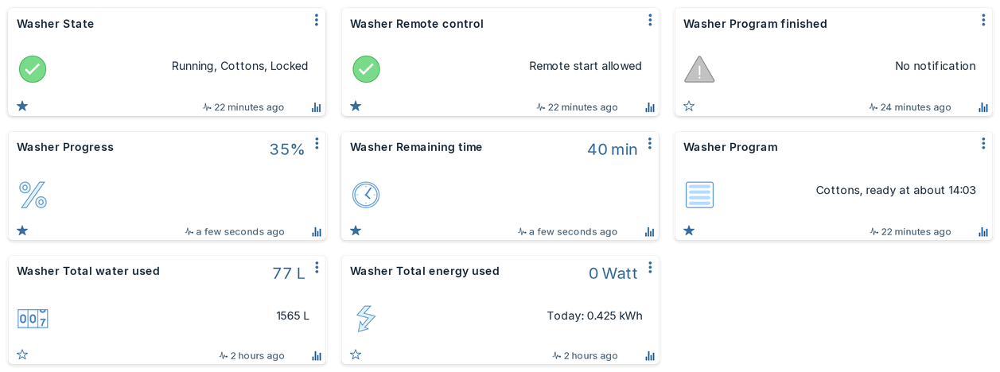

# Devices

After you sign in, every appliance on your Home Connect account gets its own set of devices.
Each device is named after the appliance (the name you gave it in the Home Connect app),
followed by what it shows, for example "Washer Remaining time" or, in Dutch, "Wasautomaat
Resterende tijd".

Every device also has a description (open the device's edit dialog) that explains what it
shows, in the device language.

## The devices every appliance gets

!!! tip "Which theme is this?"
    The screenshots show the [Machinon](https://domoticz.github.io/Machinon/docs/) theme for
    Domoticz. The plugin works the same with any theme.

Not every appliance has all of these: a fridge has no programs, so it gets no program devices,
and a hob can be monitored but not started.

| Device (English / Nederlands) | Type | What it shows |
|---|---|---|
| **State** / Status | Alert | What the appliance is doing, with the program: for example "Running, Cotton". Grey when idle or offline, green while running or waiting for a delayed start, yellow when paused, finished or aborting, orange when it needs you, red on an error. |
| **Power** / Aan/uit | Switch | Whether the appliance is on. Many appliances (washers, dryers, fridges) cannot be switched off remotely; switching them off is refused. |
| **Door** / Deur | Door contact | Open or closed. A locked door counts as closed; "Locked" then also shows in State. |
| **Progress** / Voortgang | Percentage | How far the running program is. |
| **Remaining time** / Resterende tijd | Number (min) | Minutes until the program ends. For an oven program without a set duration, the time it has been running instead. |
| **Program** / Programma | Text | The running program and when it will be ready, for example "Cotton, ready at 14:35". "about" means the appliance estimates the time. |
| **Remote control** / Bediening op afstand | Alert | Whether Domoticz may start the appliance: "Local operation", "Remote control off", "Remote control on" or "Remote start allowed". Shown only while Allow control is on. |
| **Program choice** / Programmakeuze | Selector | The selected program; with [Allow control](settings.md#allow-control) on, choosing one here selects it on the appliance. |
| **Actions** / Acties | Selector | Start, Stop, Pause, Resume, and on an oven with a motorised door Open door and Partly open door. An action the appliance does not support is refused. Only with Allow control on. |
| **Acknowledge** / Bevestigen | Push button | Confirms a message on the appliance. Only with Allow control on, and only where the appliance offers it. |
| **Start at** or **Ready at** / Start om of Klaar om | Selector | A clock time for a delayed start. Only with Allow control on. See [Control](control.md#start-later). |
| **Status code** / Statuscode | Selector | The state as a fixed number for scripts (below). Its name starts with "$", which keeps it off the dashboard. |

**Program or Program choice?** Program choice is the program that is *selected* (on the
appliance or from Domoticz), which is what Start will run; with Allow control on you change it
there. Program is a read-only summary: while a program runs it shows that program and when it
will be ready, and before that it shows the selected program marked "(selected)".

### Status code for scripts

Device names and state texts depend on the language. The Status code device gives each state
a level that never changes, so a script can rely on it:

| Level | State |
|---|---|
| 10 | Inactive |
| 20 | Ready |
| 30 | Delayed start |
| 40 | Running |
| 50 | Paused |
| 60 | Action required |
| 70 | Finished |
| 80 | Aborting |
| 90 | Error |
| 100 | Offline |

The level follows the state Home Connect reports, which can differ from what you see at the
appliance. A dryer with wrinkle guard (anti-crease) stays at 40 (Running) until the wrinkle guard
ends and only then goes to 70 (Finished); for "the laundry is dry", use its Drying finished device
([Troubleshooting](faq.md#the-dryer-stays-running-after-the-laundry-is-dry)).

The device is named with a leading "$", for example "$Washer Status code". Domoticz leaves a
device whose name starts with "$" off the dashboard, while dzVents and Lua scripts read it and
trigger on it as usual. To see it on the dashboard, rename it without the "$".

Installed 0.1.0-beta.2 or earlier? There the device was created as not used, and dzVents and Lua
do not reliably see a device that is not used. Under Setup > Devices, filter on the hardware and
add the Status code device with the green arrow. The plugin gives it the "$" name by itself,
unless you renamed it.

For a ready-made script that sends a notification when a program has finished, see
[Script examples](scripts.md#notify-when-an-appliance-has-finished).

## Options, settings and other values

Besides the devices above, the plugin creates a device for each value an appliance reports:

- **Program options** such as temperature, spin speed or duration. An option you can change
  is a setpoint, selector or switch; one you cannot change only shows its value. Changing one
  works only with Allow control on. Durations are shown and entered in minutes, even though Home
  Connect works in seconds. Options are created hidden, except the oven's set temperature, the
  duration and a washer's or dryer's process phase: the Program device already names the
  program that runs.
- **Appliance settings** such as child lock or a fridge temperature. These are created hidden,
  except a fridge's or freezer's temperature setpoints and super modes, which are how you
  operate those appliances.
- **Status values** such as the oven cavity temperature or the dishwasher's program phase. The
  program phase shows "Not running" once the program has ended.
- **Messages** (events) such as "Program finished", "Rinse aid nearly empty" or "Preheat
  finished", each as an alert device that lights up while the message is active and clears when
  it ends. Every message is shown, also one the plugin has no name for, because a message is
  what you put a notification on. Only feedback prompts ("Rate drying: cupboard dry") and the
  dryer's cool-down are created hidden.

Also created hidden:

- Values the plugin has no name for (Home Connect adds new ones over time). They get the name
  Home Connect sends.
- Diagnostics and values that repeat another device: interior light, the remote start times,
  the cloud connection, how the program ended, the dishwasher's eco dry, and the dryer's
  Connected Dry status and version and refresher water.
- **Remote control**, while Allow control is off (see
  [Settings](settings.md#allow-control)).

Hidden or shown is decided once, when a device is created, so an existing install keeps the
devices it has as they are. Showing or hiding one yourself is never undone by the plugin; the
devices that follow Allow control change only when you switch that setting.

**Where are the hidden devices?** Under **Setup > Devices**. Filter on the hardware, and use the
green arrow on a device to add it to the dashboard. Scripts (dzVents, Lua) only reliably see a
device once it is added: a hidden device is not used, and Domoticz does not load it for scripts.
To give a script a device without putting it on the dashboard, add it and rename it with a
leading "$".

## Washing machine meters

A washing machine reports four lifetime totals at the end of each program. The plugin shows them
as Domoticz meters, so Domoticz's log graphs show the use per day, month and year. Another
appliance that reports the same energy or water totals gets the same meters; so far only washing
machines are known to do so.

| Device | Meter | Unit |
|---|---|---|
| Total energy used / Totaal energieverbruik | Energy (kWh) | kWh |
| Total water used / Totaal waterverbruik | Counter | litres |
| Total detergent / Totaal wasmiddel | Counter | ml |
| Total softener / Totaal wasverzachter | Counter | ml |

Good to know:

- A meter appears the first time the washer reports that total, at the end of a program. Energy
  and water come with every program; detergent and softener only with a program that doses
  them, so those two can appear later.
- The use lands in the hour the program ended, not spread over the run.
- The energy meter always shows 0 W: Home Connect reports energy used, not live power.

## When the appliance or the connection is away

- An appliance that is switched off at the mains or has lost Wi-Fi shows **Offline** in State,
  and its other devices keep their last values.
- When the plugin has not heard from Home Connect for more than 5 minutes, State adds
  "(last known)". It disappears at the next update.
- Devices are never deleted by the plugin. An appliance you remove from your Home Connect
  account keeps its devices in Domoticz until you delete them.
