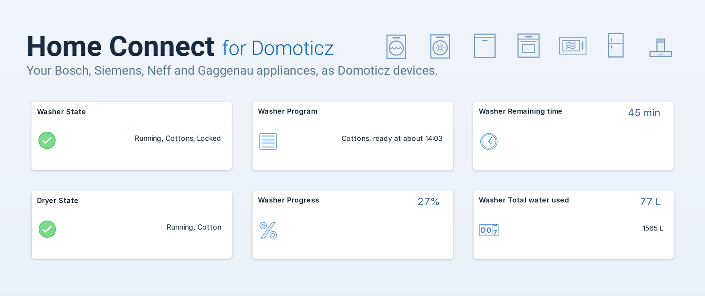

# Home Connect for Domoticz

Bring your Bosch, Siemens, Neff and Gaggenau appliances into Domoticz. The plugin connects to
the Home Connect cloud, the same service the Home Connect app uses, and keeps a device in
Domoticz for everything your appliances report: whether the washing machine is running, how long
the dishwasher still needs, the oven temperature, a rinse aid warning.

!!! note "Beta"
    Version 0.1.0-beta.1 is the first public release. It is used every day on a household of
    real appliances, but expect rough edges. Please report what you run into on
    [GitHub](https://github.com/Rouzax/home-connect-domoticz-plugin/issues).

## What you can do with it

- **See every appliance at a glance.** Washers, dryers, dishwashers, ovens, microwaves, fridges
  and the other Home Connect appliance types appear by themselves after you sign in.
- **Follow a program.** State, program, progress, remaining time and the time it will be
  ready, updated within seconds from Home Connect's event stream.
- **Automate on it.** A Status code device gives every state a fixed number, so a dzVents or
  Lua script keeps working whatever language the devices are in.
- **Get alerts.** Appliance messages such as "program finished", "rinse aid nearly empty" or
  "preheat finished" become Domoticz alert devices you can notify on.
- **Track the washing machine's use.** Its lifetime energy, water, detergent and softener totals
  are Domoticz meters, so you see the use per day, month and year.
- **Operate appliances (optional).** Choose a program, change its options, start, stop, pause
  or resume it, or set it to start later. This is off until you turn on
  [Allow control](settings.md#allow-control).

## Where to start

1. [Installation](install.md): the Home Connect developer account, installing the plugin and
   signing in. Allow about 15 minutes the first time.
2. [Devices](devices.md): what each device means.
3. [Control](control.md): only if you want to operate appliances from Domoticz.

Something not working? [Troubleshooting](faq.md) is organised by what you see.
